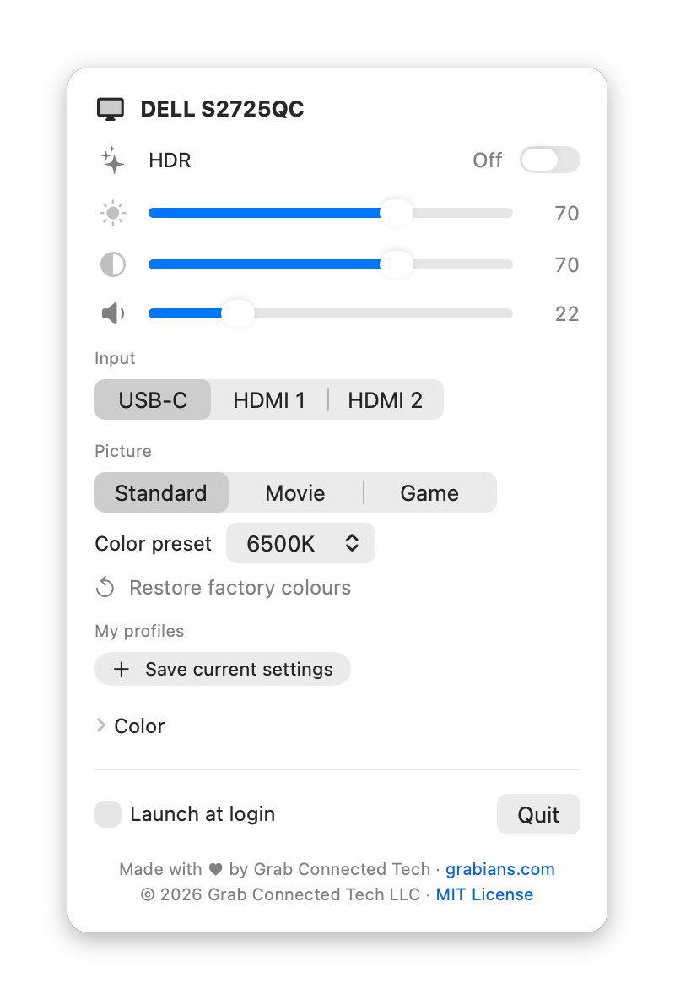

# DisplayDial: control your external monitor's brightness, volume and input from your Mac

**DisplayDial is a free, open-source macOS menu bar app that controls an external monitor's hardware settings (brightness, contrast, speaker volume, input source, picture modes, colour presets and RGB colour) directly from your Mac over DDC/CI.** It is native Swift/SwiftUI, has no dependencies, and the whole app is under 300 KB.

<p align="center">
  <picture>
    <source media="(prefers-color-scheme: dark)" srcset="docs/panel-dark.png">
    
  </picture>
</p>

It was built for a **Dell S2725QC connected over USB-C to an Apple Silicon Mac**. It should work with most DDC/CI-capable monitors from Dell, LG, Samsung, BenQ, ASUS and others.

DisplayDial is made and maintained by **[Grab Connected Tech](https://www.grabians.com/?utm_source=github&utm_medium=readme&utm_campaign=displaydial)**, a software development company founded by Abhilash Reddy and Greg Krabbenhoft. We build custom web and mobile apps for startups and small to mid-sized businesses. We made this one for our own monitor and decided to give it away.

---

## Contents

- [Features](#features)
- [Requirements](#requirements)
- [Install](#install)
- [Build from source](#build-from-source)
- [How it works](#how-it-works)
- [Troubleshooting](#troubleshooting)
- [FAQ](#faq)
- [Project structure](#project-structure)
- [Contributing](#contributing)
- [License](#license)
- [About Grab Connected Tech](#about-grab-connected-tech)

---

## Features

| Control | What it does | DDC/CI VCP code |
|---|---|---|
| Brightness | Changes the monitor's real backlight, not a software dimming overlay | `0x10` |
| Contrast | Hardware contrast | `0x12` |
| Volume | Volume of the monitor's built-in speakers or headphone jack | `0x62` |
| Mute | Click the speaker icon: sets volume to 0, and clicking again restores the previous level | `0x62` |
| Input source | Switch between the inputs your monitor reports, e.g. USB-C, HDMI 1 and HDMI 2 | `0x60` |
| Picture mode | The monitor's built-in modes, e.g. Standard, Movie and Game | `0xDC` |
| Colour preset | The monitor's built-in colour presets, e.g. sRGB, 6500K, 9300K and User | `0x14` |
| Colour (RGB gain) | Fine-tune red, green and blue | `0x16`, `0x18`, `0x1A` |
| Restore factory colours | Resets the colour preset and RGB to the monitor's factory defaults. Click twice to confirm. | `0x08` |
| HDR | Shows whether the monitor supports HDR and whether it's on, with a switch to turn it on or off | (macOS, not DDC) |
| My profiles | Save the current picture settings under a name and apply them in one click | (stored in the app) |

Also:

- **Adapts to your monitor.** DisplayDial reads the monitor's capabilities and shows only the controls, inputs, modes and presets it supports.
- **Lives in the menu bar.** It has no Dock icon and no windows to manage.
- **Re-reads the monitor each time you open it**, so changes made with the monitor's own buttons show up.
- **Smooth slider dragging.** Only the latest value is sent to the monitor, so it never falls behind.
- **HDR status and switch.** The HDR row shows *On*, *Off* or *Not supported*. When HDR is on, it reminds you that the monitor locks brightness and contrast.
- **Launch at login** toggle.
- **Multiple monitors.** With more than one external monitor, a picker at the top of the panel switches between them, so the panel stays the same size. Each monitor keeps its own HDR switch and saved profiles, even two of the same model.
- **Plug and unplug freely.** Monitors connected or reconnected while the app is running show up automatically.

## Requirements

- **A Mac with Apple Silicon** (M1, M2, M3, M4 or later). Intel Macs are not supported.
- **macOS 14 Sonoma or later.**
- **A monitor with DDC/CI enabled.** Most monitors have it on by default. On Dell monitors it's under *Menu › Others › DDC/CI*.
- **A direct connection** over USB-C, Thunderbolt or DisplayPort. See [which connections work](#which-connections-work).

## Install

### From the DMG

1. Download `DisplayDial.dmg` from the Releases page.
2. Open it and drag **DisplayDial** into **Applications**.
3. Open DisplayDial. macOS will warn that it can't verify the developer, because the app isn't notarized.
4. Go to **System Settings › Privacy & Security**, scroll down and click **Open Anyway**.
5. Click the ☀️ icon in the menu bar.

### From source

```bash
git clone <repo-url> DisplayDial
cd DisplayDial
./build.sh install
```

## Build from source

The only requirement is the **Xcode Command Line Tools**; you don't need the full Xcode app. Install them with `xcode-select --install`.

| Command | Result |
|---|---|
| `./build.sh` | Builds `build/DisplayDial.app` |
| `./build.sh install` | Builds, copies it to `/Applications` and launches it |
| `./build.sh screenshots` | Renders `docs/panel-light.png` and `docs/panel-dark.png` from your connected monitor, for the README |
| `./build.sh dmg` | Builds and packages `build/DisplayDial.dmg` for sharing |
| `./build.sh check` | Self-check: tests the capabilities parser, then changes the monitor's volume by one step, reads it back and restores it |

## How it works

Monitors expose their on-screen-menu settings over **DDC/CI** (Display Data Channel Command Interface), a VESA standard. Each setting is a numbered "VCP" code defined by the **MCCS** spec. For example, brightness is `0x10` and volume is `0x62`.

The HDR switch isn't DDC. It uses the same private SkyLight calls that macOS's own Displays settings use (`SLSDisplaySupportsHDRMode`, `SLSDisplayIsHDRModeEnabled` and `SLSDisplaySetHDRModeEnabled`). These are looked up when the app runs, so if a future macOS removes them, the switch is hidden instead of crashing the app.

On Apple Silicon Macs, DisplayDial sends these commands with IOKit's `IOAVService` I²C functions, as MonitorControl, Lunar and m1ddc do. These functions are **private Apple APIs**, which is why DisplayDial can't be distributed on the Mac App Store.

When the panel first opens, DisplayDial asks the monitor for its **capabilities string**. That's the monitor's own list of the VCP codes it supports and the values each one accepts; for example, the Dell S2725QC reports `60(1B 11 12)` for its three inputs and `DC(00 03 05)` for its three picture modes. The panel is built from that list, with the values labelled using the standard MCCS names.

**Telling monitors apart.** Every external monitor has its own DDC service in macOS's I/O Registry, listed just after the display hardware entry that carries the monitor's vendor ID, product ID, serial number and name. DisplayDial pairs each service with the right screen by comparing those values with what macOS reports for each display, so controls never end up on the wrong monitor. Saved profiles are stored under the monitor's vendor, model and serial number, so two identical monitors each keep their own. The list is rebuilt whenever the panel opens or a monitor is connected or removed.

Each write is sent twice, because monitors occasionally drop a DDC command. Reads are retried up to four times, and each reply's checksum is checked before it's used.

## Troubleshooting

### Brightness and contrast sliders don't change anything

**The most common cause is HDR.** When macOS drives a monitor in HDR mode, most monitors (including Dell) lock brightness, contrast and colour presets. Turn off the **HDR** switch in DisplayDial's panel, or go to **System Settings › Displays › [your monitor] › High Dynamic Range**.

Also check the monitor's own menu for modes that lock brightness, such as *Dynamic Contrast*, *Smart HDR*, *ComfortView Plus* or *Eco*. Switching the preset mode to **Standard** usually unlocks it.

### "No hardware controls on this connection"

The monitor is connected, but DisplayDial can't reach its settings over DDC/CI. The HDR switch still works, because that's a macOS setting.

- DDC/CI may be switched off in the monitor's menu.
- The connection may not carry DDC, for example a DisplayLink dock or the M1 Mac mini's HDMI port. See below.
- The monitor may be asleep. Wake it and open the panel again.

### "No external display connected"

macOS doesn't see an external monitor. Check the cable, and that the monitor is on the right input.

### Which connections work?

| Connection | DDC/CI works? |
|---|---|
| USB-C / Thunderbolt (DisplayPort Alt Mode) | ✅ Yes |
| USB-C to DisplayPort cable | ✅ Yes |
| Thunderbolt dock with DisplayPort/HDMI output | ⚠️ Usually; depends on the dock |
| Built-in HDMI port on M1 and entry-level M2 Mac mini | ❌ No; Apple's HDMI chip blocks DDC on these models |
| DisplayLink docks and adapters | ❌ No; DisplayLink doesn't pass DDC through |

### The Mac's picture disappeared after switching input

That's expected. Switching the monitor to HDMI shows the other device, and the Mac can't switch it back because its video link is no longer active. Use the monitor's buttons to choose USB-C again.

### Run the self-check

```bash
./build.sh check
```

If it prints `DDC OK`, your Mac and monitor can talk to each other and the problem is a monitor setting, not the connection.

## FAQ

### How do I change a Dell monitor's brightness from my Mac?

Install DisplayDial, click the ☀️ icon in the menu bar and drag the **Brightness** slider. It changes the monitor's real backlight over DDC/CI, the same as using the monitor's own menu. This works over USB-C, Thunderbolt or DisplayPort on Apple Silicon Macs.

### Can I control my monitor's speaker volume from macOS?

Yes. macOS's volume keys don't control speakers built into a USB-C or DisplayPort monitor, but DisplayDial's **Volume** slider sets the monitor's own volume over DDC/CI. Click the speaker icon to mute.

### Can I switch my monitor's input from my Mac?

Yes. The **Input** buttons send the DDC input-select command (`0x60`). DisplayDial shows the inputs your monitor lists in its capabilities, such as USB-C (`0x1B` on Dell), HDMI 1 (`0x11`), HDMI 2 (`0x12`) and DisplayPort (`0x0F`).

### Can I switch my monitor's picture mode or colour preset from my Mac?

Yes. Under **Picture**, DisplayDial shows the monitor's built-in picture modes (such as Standard, Movie and Game) and colour presets (such as sRGB, 6500K and 9300K), the same ones in the monitor's own menu. Choosing one switches the monitor, and DisplayDial then re-reads the brightness and colour values that preset loads.

### Can I create and save my own monitor colour profiles?

Yes. Set the monitor up the way you like it, then click **Save current settings** under **My profiles** and give it a name, like "Night" or "Photo editing". Click a profile to apply it. Right-click it to update it to the current settings or delete it. A profile stores the picture mode, colour preset, brightness, contrast and RGB gains.

Profiles are saved on your Mac, not in the monitor, because DDC/CI can't create new presets inside a monitor.

### How do I turn HDR on or off for an external monitor from the menu bar?

Open DisplayDial and use the **HDR** switch. It shows whether your monitor supports HDR and whether it's currently on. This is the same setting as **System Settings › Displays › High Dynamic Range**, without going through Settings. The screen blinks for a moment while macOS switches modes.

### How do I reset my monitor's colours to the original factory settings?

Under **Picture**, click **Restore factory colours**, then click again to confirm. This sends the standard MCCS "restore factory colour defaults" command (`0x08`), the same reset as in the monitor's own menu. On the Dell S2725QC it sets the colour preset to 6500K and red, green and blue to 100. If you want to come back to your current colours later, save them as a profile first.

### Why does changing red, green or blue switch my monitor's colour preset?

Most monitors only allow manual RGB in their custom or user preset. Dell monitors, for example, switch to *User 2* (Custom Color) as soon as an RGB value changes. When you apply a saved profile, DisplayDial only restores RGB values if the profile was saved on a user preset, so applying a profile won't move you off a preset like sRGB.

### Is this the same as a macOS colour profile (ICC profile)?

No. DisplayDial changes the **monitor's own hardware settings**. An ICC colour profile is a separate, software-side correction that macOS applies to everything it sends to the screen. You choose that in **System Settings › Displays › Color profile**. The two work together.

### Why doesn't mute use the DDC mute command?

Many monitors, including the Dell S2725QC, don't implement the MCCS mute code (`0x8D`). DisplayDial mutes by setting the volume to 0 and remembers the previous level for when you unmute.

### Does DisplayDial work on Intel Macs?

No. DisplayDial only uses the Apple Silicon (`IOAVService`) DDC path. Intel Macs need a different method that hasn't been added.

### Does it work over HDMI?

It works over HDMI on most Apple Silicon Macs, but not through the built-in HDMI port on the M1 and entry-level M2 Mac mini. USB-C or DisplayPort is the most reliable.

### Is it safe? Can it damage my monitor?

DisplayDial only sends standard MCCS commands, which are the same ones the monitor's on-screen menu changes. It doesn't change power, firmware or factory settings.

### Why isn't it on the Mac App Store?

On Apple Silicon, DDC/CI is only reachable through private IOKit APIs, and the App Store doesn't allow those.

### How is it different from MonitorControl, Lunar or BetterDisplay?

Those are full-featured, mature apps. DisplayDial does only hardware monitor controls in a single menu bar panel: two Swift files, no dependencies and under 300 KB. Choose DisplayDial if you want something small you can read end to end. Choose the others for keyboard brightness keys, automatic adjustment or virtual displays.

### Does DisplayDial work with multiple monitors?

Yes. Each external monitor connected over USB-C, Thunderbolt or DisplayPort gets its own controls. Use the picker at the top of the panel to switch between them. DisplayDial matches each monitor by its vendor, model and serial number, so two identical monitors are kept apart, each with its own HDR switch and saved profiles. A monitor on a connection without DDC/CI, such as a DisplayLink dock, is listed with a "No hardware controls on this connection" note, and only its HDR switch.

So far DisplayDial has been tested on real hardware with one external monitor. Reports from multi-monitor setups are very welcome.

### Does DisplayDial collect any data?

No. It has no network access, analytics or accounts. It only talks to your monitor.

### Who makes DisplayDial?

DisplayDial is made by [Grab Connected Tech](https://www.grabians.com/?utm_source=github&utm_medium=readme&utm_campaign=displaydial), a software development company founded by Abhilash Reddy and Greg Krabbenhoft. Grab Connected Tech builds custom web and mobile apps and provides DevOps, application maintenance and IT consulting for startups and small to mid-sized businesses. See [About Grab Connected Tech](#about-grab-connected-tech).

## Project structure

```
DisplayDial/
├── Sources/
│   ├── App.swift          # SwiftUI menu bar app and panel UI
│   ├── DDC.swift          # DDC/CI over IOAVService: finding monitors, reading and writing VCP codes
│   └── Screenshots.swift  # README screenshot renderer, only built by ./build.sh screenshots
├── Tests/
│   └── main.swift         # Self-check: capabilities parser + hardware round-trip (./build.sh check)
├── docs/                  # README screenshots
└── build.sh               # Build, install, DMG, screenshot and self-check commands
```

## Contributing

Issues and pull requests are welcome. These are especially useful:

- **Names for brand-specific codes.** Monitors sometimes use values outside the MCCS standard (like Dell's `0x1B` for USB-C). These show up as hex until they're named.
- **Reports of which monitors work.** Include the model, the connection type and your Mac model.
- **Intel Mac support.**

Please run `./build.sh check` with your monitor connected before opening a pull request that touches `DDC.swift`.

## License

DisplayDial is released under the [MIT License](LICENSE). © 2026 Grab Connected Tech LLC.

## About Grab Connected Tech

DisplayDial is built and maintained by **Grab Connected Tech**, a software development company founded by **Abhilash Reddy** and **Greg Krabbenhoft**. We operate in the US as Grab Connected Tech LLC and in India as Grabians Connected LLP.

We build custom software for startups and small to mid-sized businesses: web apps, mobile apps, internal tools, DevOps and cloud setup, and ongoing maintenance and support for software that's already in production. Most of our client work is in healthcare, finance, retail and logistics.

DisplayDial is a good sample of how we work. It's small and has no dependencies. Every reply from the monitor is checksummed before it's trusted. It also handles the awkward cases, like monitors that drop commands, two identical screens on one Mac and cables that don't carry DDC, instead of ignoring them. We bring the same habits to client projects.

If you have something that needs building, or an app that needs someone to look after it, talk to us at **[grabians.com](https://www.grabians.com/?utm_source=github&utm_medium=readme&utm_campaign=displaydial)**.

